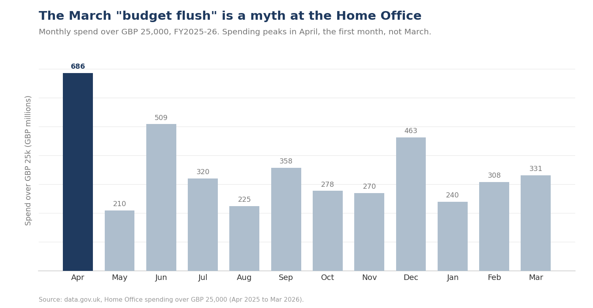
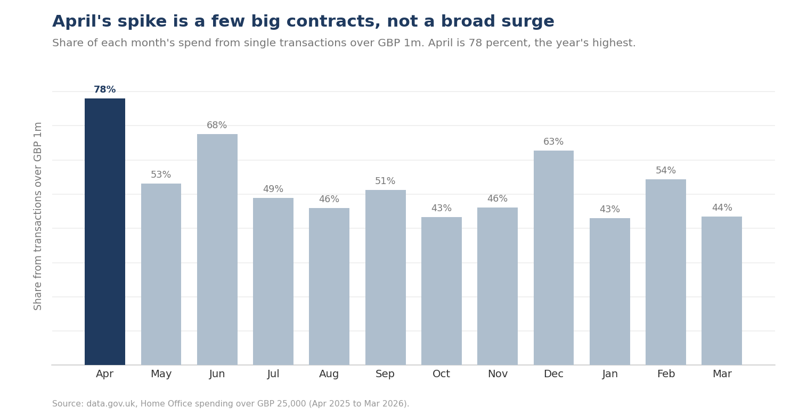

# Does the UK government really dump its budget in March?

A data analysis testing the "use it or lose it" year-end spending belief
against 12 months of **Home Office spending over £25,000** open data
(financial year 2025-26, April 2025 to March 2026).

**Short answer: not at the Home Office.** The March flush does not show up.
Spending instead peaks in **April**, the *first* month of the financial year,
and that peak is driven by a handful of large annual contracts, not a broad surge.

---

## The finding



March is only the **5th largest month** of the year by spend (£331m). The
largest by far is **April at £686m**, roughly triple the quietest month (May, £210m).
That is the opposite of the "spend it before year end" story.

### But a total can be faked by one big contract, so I tested it three ways

A spike in total spend alone proves nothing: a single large contract can create it.
So I checked each month on three measures: total value, **transaction count**, and the
**share of spend coming from single transactions over £1m**.



In April, **78% of spend came from transactions over £1m** (the year's highest),
the median transaction was actually the *lowest* of the year, and the transaction
count was unremarkable. In other words, April is a few big annual contracts booked
at the start of the year, not everyone spending more. Transaction *count* peaks in
December and September, not March either.

**Conclusion:** at the Home Office in FY2025-26, spending is front-loaded into April
via large contracts. The March budget flush is a myth here.

---

## Why this is interesting

The "use it or lose it" year-end surge is well documented in the **US** (federal
year end, September; see Liebman & Mahoney, *Do Expiring Budgets Lead to Wasteful
Year-End Spending?*). It is far less studied in the **UK**, where the year ends in
March. This is a small, honest UK data point that pushes against the folklore.

## Honest limitations

- **One department, one year.** This is the Home Office, FY2025-26 only. It does
  **not** generalise to "UK government". Other departments or years may differ.
- Only covers spend **over £25,000** (the transparency threshold), so smaller
  spending is invisible.
- ~29% of rows are below £25k (line items of larger transactions); refunds appear
  as negatives. These are documented and handled in the script.

## Data quality notes (the unglamorous part that matters)

The raw monthly files needed real cleaning before any analysis:
- mixed encodings (UTF-8 BOM on some files, Windows-1252 on another),
- one month uploaded twice (de-duplicated),
- date parsing and consistent month keys,
- outlier awareness (a single £58m accommodation contract).

## How the analysis is built

- **SQL (`queries.sql`)** — the core analysis in T-SQL: the monthly summary, the
  three-way test, the over-£1m contract share, the month ranking, and the top
  April suppliers. This is the primary analysis layer.
- **Power BI** — an interactive dashboard of the same analysis (monthly spend,
  contract-share, supplier drill-down) is the visual layer. *(dashboard screenshots
  to follow)*
- **Python (`analysis.py`)** — a reproducible pipeline that cleans the 12 raw files
  (encodings, de-duplication, date parsing) and regenerates the charts end to end.

## Reproduce it

Run the analysis in SQL (load `data/ho_fy2526_combined.csv` into `dbo.ho_spend`,
then run `queries.sql`), or reproduce the full pipeline and charts in Python:

```bash
pip install -r requirements.txt
python analysis.py        # uses the committed cleaned data out of the box
```

## Stack
**SQL (T-SQL) · Power BI · Python (pandas, matplotlib)** · data modelling · data quality.

---
*Data: data.gov.uk, Home Office spending over £25,000. Crown copyright, Open Government Licence v3.0.*
